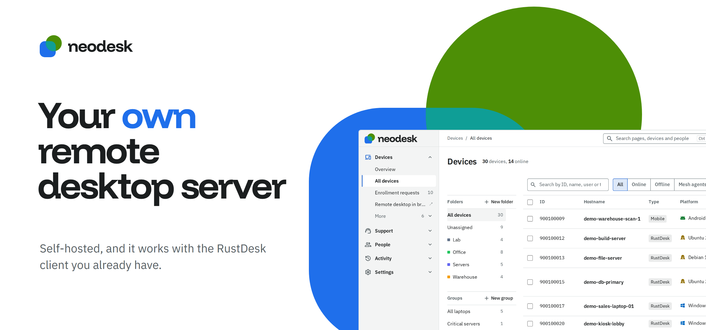
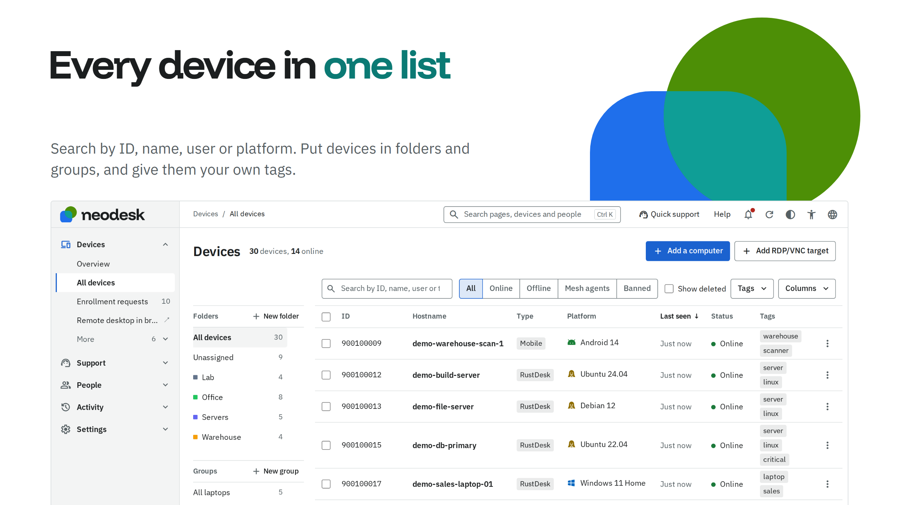
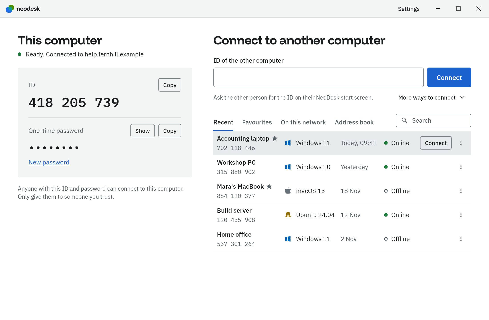

<p align="center">
  <a href="https://neode.sk">
    <picture>
      <source media="(prefers-color-scheme: dark)" srcset="img/hero-dark.png">
      
    </picture>
  </a>
</p>

<p align="center">
  <a href="https://neode.sk"><picture><source media="(prefers-color-scheme: dark)" srcset="badges/dark/website.svg"></picture></a>
  <a href="https://docs.neode.sk"><picture><source media="(prefers-color-scheme: dark)" srcset="badges/dark/docs.svg"></picture></a>
  <a href="https://discord.gg/nwERSawufr"><picture><source media="(prefers-color-scheme: dark)" srcset="badges/dark/discord.svg"></picture></a>
  <a href="https://github.com/neodeskapp/neodesk/discussions"><picture><source media="(prefers-color-scheme: dark)" srcset="badges/dark/discussions.svg"></picture></a>
  <a href="https://github.com/neodeskapp/neodesk/blob/main/LICENSE"><picture><source media="(prefers-color-scheme: dark)" srcset="badges/dark/license.svg"></picture></a>
</p>

NeoDesk is a remote desktop server you run yourself, with a web console for
the devices you look after and a desktop client for Windows, macOS and Linux.
It speaks the RustDesk protocol, so the stock RustDesk client connects to it
too. Your data stays on your server: the project sends no analytics, crash
reports or usage data anywhere.

## The server and its web console

<a href="https://github.com/neodeskapp/neodesk">
  <picture>
    <source media="(prefers-color-scheme: dark)" srcset="img/console-dark.png">
    
  </picture>
</a>

One Go binary does the work of RustDesk's hbbs and hbbr, answers the client
API and serves the console. It stores its data in SQLite or PostgreSQL. In
the console you search and sort your devices, approve new ones, connect from
the browser, and give each person their own account and role.
[neodeskapp/neodesk](https://github.com/neodeskapp/neodesk) has the code,
the installers and the Docker setup.

## The desktop client

<a href="https://github.com/neodeskapp/neodesk-client">
  <picture>
    <source media="(prefers-color-scheme: dark)" srcset="img/client-dark.png">
    
  </picture>
</a>

A fork of RustDesk with no public server built in. An invite link from the
console installs it and joins the computer to your server. It is in
[neodeskapp/neodesk-client](https://github.com/neodeskapp/neodesk-client).

## Install the server

On a Linux server, this sets up the Docker image and prints the admin
password at the end:

```bash
curl -fsSL https://neode.sk/install.sh | sudo bash
```

The [documentation](https://docs.neode.sk) has the other ways to install,
including Windows and Linux without Docker, and how to connect a client.

## Repositories

| Repository | What it is |
|---|---|
| [neodesk](https://github.com/neodeskapp/neodesk) | The server and the web console, with the installers and the Docker setup. Start here. |
| [neodesk-client](https://github.com/neodeskapp/neodesk-client) | The desktop client, a fork of [rustdesk/rustdesk](https://github.com/rustdesk/rustdesk). |
| [hbb_common](https://github.com/neodeskapp/hbb_common) | The protocol and config library the client builds on, a fork of [rustdesk/hbb_common](https://github.com/rustdesk/hbb_common). |
| [website](https://github.com/neodeskapp/website) | The neode.sk website and the documentation. |

## Help and contributing

Ask on the [NeoDesk Discord](https://discord.gg/nwERSawufr) or in
[GitHub Discussions](https://github.com/neodeskapp/neodesk/discussions).
Changes come in as pull requests; the
[contributing guide](https://docs.neode.sk/development/contributing/) says
what one needs. Report a security problem privately, as the
[security policy](https://github.com/neodeskapp/.github/blob/main/SECURITY.md)
describes.

NeoDesk is under the [AGPL-3.0](https://github.com/neodeskapp/neodesk/blob/main/LICENSE).
The server is a modified version of
[BetterDesk](https://github.com/UNITRONIX/BetterDesk) by UNITRONIX, and the
client is built on [RustDesk](https://github.com/rustdesk/rustdesk).
